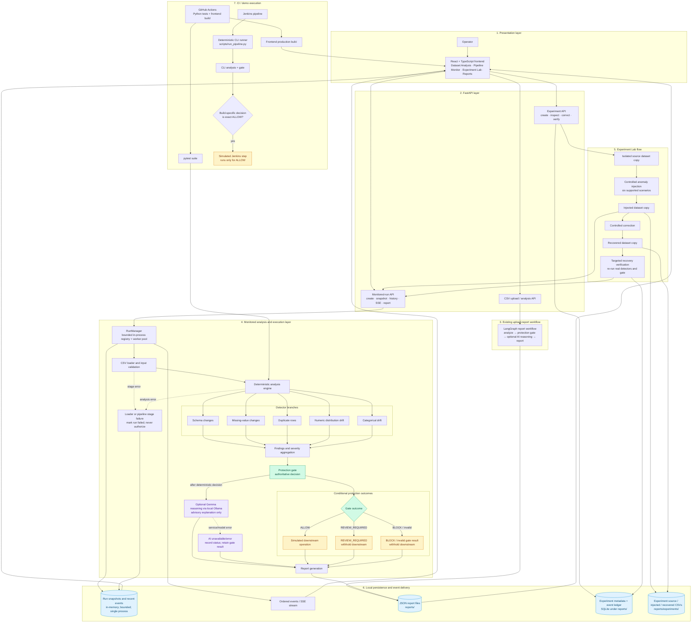

# DataSentinel AI

> **AI-Powered Data Observability & Pipeline Protection Platform**  
> *Detect silent data failures before they reach downstream analytics, ML models, and executive dashboards.*

[](https://www.python.org/)
[](https://fastapi.tiangolo.com/)
[](https://github.com/langchain-ai/langgraph)
[](https://ollama.com/)
[](https://react.dev/)
[](https://www.typescriptlang.org/)
[](https://tailwindcss.com/)
[](https://docs.pytest.org/)

---

## 1. Executive Summary

In enterprise environments, data moves through complex ETL/ELT pipelines before feeding business dashboards, automated fraud engines, financial reports, and AI/ML algorithms.

A pipeline can execute with exit code `0` (Success) while the **data itself is severely corrupted**:
- **Silent Distribution Shift:** Transaction amounts previously denominated in INR are inadvertently ingested in USD, distorting financial calculations 80-fold.
- **Null Invariant Ruptures:** Critical features (e.g. `customer_age`) experience sudden null spikes due to an unannounced upstream schema migration.
- **Duplication Spikes:** Ingestion retry loops replay records without deduplication, inflating metric volumes.
- **Category Drift:** Unhandled enum tokens (e.g., `'Unknown'`) bypass upstream validation, contaminating downstream segmentation.

**DataSentinel AI** provides data observability by comparing uploaded datasets against trusted reference baselines. It pairs **deterministic detectors** (Kolmogorov-Smirnov, Chi-square, and Total Variation Distance) with an optional **LangGraph-orchestrated reasoning agent powered by Gemma 3 1B**, enforcing an **authoritative, fail-closed Protection Gate** (`ALLOW`, `REVIEW_REQUIRED`, `BLOCK`).

---

## 2. The Four Pillars of DataSentinel AI

| Stage | Mechanism | Responsibility |
| :--- | :--- | :--- |
| **1. Detect** | Python & SciPy | Calculates distribution statistics, p-values, missingness changes, duplicate-row rates, categorical drift, and schema differences. The LLM does not calculate measured values. |
| **2. Investigate** | Python API and workflow | The monitored-run path explicitly sequences analysis, gate evaluation, optional AI reasoning, and conditional downstream execution. The separate report workflow also uses LangGraph. |
| **3. Explain** | Gemma 3 1B (via Ollama) | Analyzes measured facts to formulate unverified root-cause hypotheses, assess business impacts, and recommend verification checklists in plain language. |
| **4. Protect** | Deterministic Safety Gate | Authoritative gate evaluates finding severities. If critical risks are detected, it issues a **BLOCK** decision that **cannot be overridden by the LLM**. |

---

## 3. Architecture & Data Flow



### Runtime and branch semantics

- The monitored execution path loads both CSVs, runs the deterministic
  detectors, evaluates the protection gate, optionally requests an AI
  explanation, and then invokes simulated downstream processing only for a
  consistent `ALLOW`. `REVIEW_REQUIRED`, `BLOCK`, invalid decisions, and
  failed analysis do not authorize downstream work.
- The AI path is advisory. If Ollama/Gemma is unavailable or errors, that
  status is recorded; the deterministic gate remains authoritative.
- The detector fan-out and frontend branches describe logical dependencies
  and displayed stages. They do **not** assert parallel detector execution or
  a production downstream integration. The upload-report API and monitored-run
  API are distinct paths: the former invokes the LangGraph report workflow,
  while the latter uses the instrumented run manager and conditional simulated
  downstream stage.
- Run snapshots and event history are bounded in-memory state in a
  single-process manager. Reports are local JSON files. Experiment metadata
  and its append-only event ledger use SQLite, while isolated CSV versions are
  stored under `reports/experiments/`.
- The Experiment Lab modifies isolated copies, uses the same monitored
  analysis/gate behavior, and verifies a targeted recovery by rerunning the
  actual detectors. It is not a general lineage or governed-baseline service.
- The CI portion is separate from the live API runtime. GitHub Actions runs
  tests/build; Jenkins uses the CLI decision artifact and only executes its
  simulated downstream stage for `ALLOW`.

### Why Deterministic Gating Over Pure LLMs?
LLMs are creative reasoners, but they can hallucinate or downplay statistical severity. In DataSentinel AI:
1. **Math is executed by Python:** KS p-values, mean shifts, and null ratios are computed using standard statistical libraries.
2. **The Protection Gate is absolute:** If an anomaly is ranked `critical` or high-severity rules trigger, the decision is **BLOCK**. An LLM explanation can never override this decision.
3. **Fail-Closed Design:** If Ollama or the reasoning agent encounters an error, the system records the failure but continues to enforce pipeline protection.

---

## 4. Real-World Demonstration Case

The repository includes a verified real-world incident dataset (`data/raw/baseline.csv` vs `data/raw/current.csv`):

| Finding | Column | Evidence | Severity | Detection Method |
| :--- | :--- | :--- | :--- | :--- |
| **Missing Values** | `customer_age` | Missingness jumped from **0.00% to 30.18%** (332 affected records). | `HIGH` | `missing_value_percentage` |
| **Duplicate Records** | Global | Duplicates increased from **0.00% to 9.09%** (100 duplicated rows). | `MEDIUM` | `duplicate_row_comparison` |
| **Distribution Drift**| `transaction_amount` | Baseline mean of **497.33** shifted to **1490.27** (KS stat: 0.963, p-value < reported precision). | `HIGH` | `summary_statistics_and_ks_test` |
| **Categorical Drift** | `payment_status` | Introduction of new **`Unknown`** category (TVD: 0.318, $\chi^2$: 382.68). | `HIGH` | `total_variation_distance_and_chi_square` |

**Outcome:**
- **Overall Status:** `CRITICAL`
- **Protection Decision:** `BLOCK`
- **Downstream Processing:** Not permitted automatically
- **Human Review:** Mandatory before production release

---

## 5. Enterprise Frontend Workspace

The frontend is designed for cybersecurity operations centers and data infrastructure teams:

1. **Command Centre (Overview):**
   - High-density observability metrics (Health Score, High-Severity counts, Reference Pipeline state).
   - Prominent Protection Gate status banner.
   - Severity distribution donut and historical run trends.
   - Recent incident streams and AI investigation preview.

2. **Pipeline Monitor:**
   - Live, directed dependency graph with a visible branch from the protection
     gate into AI investigation and gate-controlled downstream processing,
     joining at report generation.
   - Nodes show actual backend status, measured duration, and safe detector
     evidence; connections describe dependencies, not simulated concurrency.

3. **Anomaly Injection & Recovery Lab (Phase 3):**
   - Runs six controlled scenarios against a sample or uploaded CSV copy using
     the real detectors and protection gate.
   - Applies a narrowly scoped correction to the isolated copy and verifies
     the targeted finding with a real rerun.

4. **Dataset Analysis:**
   - Drag-and-drop dual-file uploader with size, extension, and empty file validation.
   - Preserves the existing CSV upload-and-analysis workflow. Detector
     operations do not expose incremental progress; the separate Pipeline
     Monitor reports only stage transitions and measurements actually emitted.

5. **Anomaly Explorer:**
   - Multi-criteria filtering by severity (`High`, `Medium`, `Low`), detector type, and keyword search.
   - Interactive evidence slide-over drawer with side-by-side baseline vs. current comparisons.

6. **AI Investigation Workspace:**
   - Dedicated incident analysis dashboard (Incident summary, Root-cause hypotheses with confidence ratings, Business impacts, and remediation checklist).
   - Clear visual distinction between measured facts and unverified AI hypotheses.

7. **Reports & Audit Logs:**
   - Complete historical ledger queried via `GET /api/reports`.
   - One-click inspection and JSON export (`GET /api/reports/{id}`).

8. **System Configuration (Settings):**
   - Dynamic API base URL configuration with live verification against `/api/health`.
   - Engine telemetry and statistical detector registry.

---

## 6. Project Structure

```text
DataSentinelAI/
├── .gitignore
├── .github/
│   └── workflows/                         # Python tests and frontend build
├── AI_CONFIGURATION.md                    # Local Ollama/Gemma configuration
├── DEMO_READINESS.md                      # Audit and verified readiness record
├── DEMO_RUNBOOK.md                        # PowerShell demo sequence
├── OFFLINE_SETUP.md                       # Local/offline setup notes
├── PPT.md                                  # Text transcript of the 9-slide deck
├── data/
│   ├── processed/
│   └── raw/
│       ├── baseline.csv                     # Trusted reference dataset
│       └── current.csv                      # Investigated incoming dataset
├── docs/                                    # Phase 4 demo and readiness materials
│   ├── AI_FALLBACK_AND_TROUBLESHOOTING.md
│   ├── DataSentinelAI_Demo.pptx             # 9-slide presentation
│   ├── JUDGE_QA.md
│   ├── PHASE4_DEMO_RUNBOOK.md
│   ├── PHASE4_READINESS_CHECKLIST.md
│   ├── PHASE4_VALIDATION.md
│   └── TECHNICAL_ARCHITECTURE.md
├── frontend/                                # Enterprise React + TypeScript UI
│   ├── public/
│   │   ├── favicon.svg
│   │   └── icons.svg
│   ├── src/
│   │   ├── assets/
│   │   ├── App.css
│   │   ├── App.tsx
│   │   ├── components/
│   │   │   ├── layout/                      # Sidebar and Topbar navigation
│   │   │   └── ui/                          # Badge, Card, Button, Drawer, Toast
│   │   ├── lib/
│   │   │   ├── api.ts                       # Typed REST and SSE client
│   │   │   ├── utils.ts                     # Scoring, formatting, and download utilities
│   │   │   └── react-is-shim.ts             # ESM compatibility layer
│   │   ├── pages/
│   │   │   ├── Overview.tsx                 # Command Centre
│   │   │   ├── PipelineMonitor.tsx          # Live branched DAG and SSE client
│   │   │   ├── ExperimentLab.tsx            # Controlled anomaly and recovery
│   │   │   ├── DatasetAnalysis.tsx          # Dual CSV Ingestion
│   │   │   ├── AnomalyExplorer.tsx          # Filterable Evidence Grid
│   │   │   ├── AIInvestigation.tsx          # Gemma Reasoning Workspace
│   │   │   ├── Reports.tsx                  # Historical Audit Ledger
│   │   │   └── Settings.tsx                 # Telemetry & Config
│   │   ├── types/
│   │   │   └── api.ts                       # Strict TypeScript backend schemas
│   │   ├── index.css
│   │   └── main.tsx
│   ├── index.html
│   ├── package.json
│   ├── package-lock.json
│   ├── tsconfig.json
│   └── vite.config.ts
├── reports/                                 # Reports plus ignored local experiment DB/data
├── scripts/
│   ├── create_phase4_presentation.ps1       # Windows PowerPoint deck generator
│   ├── demo_monitored_pipeline.py           # SDK fixture demonstration
│   ├── demo_preflight.py                   # Local readiness checks
│   ├── evaluate_protection.py               # Metrics and evaluation reports
│   ├── generate_protection_fixtures.py      # Deterministic scenario generator
│   ├── run_pipeline.py                      # CLI analysis and run artifacts
│   ├── start_demo.ps1                       # Start only missing localhost services
│   └── stop_demo.ps1                        # Stop only processes started by demo
├── src/
│   ├── agents/
│   │   └── reasoning_agent.py               # Gemma 3 1B structured Ollama client
│   ├── experiments/
│   │   ├── lab.py                           # Deterministic injection and recovery
│   │   └── store.py                         # SQLite metadata and isolated CSV versions
│   ├── detectors/                           # Statistical detection modules
│   │   ├── categorical_drift_detector.py    # TVD & Chi-square
│   │   ├── distribution_detector.py         # Two-sample Kolmogorov-Smirnov
│   │   ├── duplicate_detector.py            # Duplicate-row rate comparison
│   │   ├── missing_value_detector.py        # Null-rate differential analysis
│   │   └── schema_detector.py               # Structural column set changes
│   ├── graph/
│   │   └── workflow.py                      # LangGraph StateGraph orchestration
│   ├── monitoring/
│   │   ├── events.py                        # Validated event and finding schemas
│   │   ├── execution.py                     # Instrumented analysis/gate/report flow
│   │   ├── run_manager.py                   # Bounded in-memory run/event registry
│   │   └── sdk.py                           # Python PipelineRun and stage contexts
│   ├── utils/
│   │   └── data_loader.py                   # Pandas CSV loader
│   ├── analysis_engine.py                   # Deterministic detection coordinator
│   └── protection_gate.py                   # Fail-closed pipeline safety gate
├── tests/
│   ├── fixtures/protection/                 # Scenario CSV pairs and manifest
│   ├── test_api.py
│   ├── test_ai_health.py                    # Ollama availability and inference health
│   ├── test_evaluation.py
│   ├── test_experiments.py                  # Real detector/recovery/API tests
│   ├── test_monitoring.py                   # SDK and event lifecycle tests
│   ├── test_ollama_reasoning.py
│   ├── test_protection_gate.py
│   └── ...                                  # Detector and integration tests
├── Jenkinsfile                              # Build-specific decision enforcement
├── api.py                                   # FastAPI REST service
├── app.py                                   # Streamlit interface
├── README.md
└── requirements.txt
```

---

## 7. Quickstart Guide

### Prerequisites
- Python 3.11+
- Node.js 20.19+ or 22.12+ & npm (Vite 8 requirement)
- (Optional) [Ollama](https://ollama.com/) with `gemma3:1b` for local AI reasoning:
  ```bash
  ollama pull gemma3:1b
  ```
  Pull the model before going offline; application startup never downloads it.

---

### Step 1: Start the Backend API

```bash
# Activate virtual environment
.\.venv\Scripts\Activate.ps1    # On Windows
# source .venv/bin/activate       # On Linux/macOS

# Install dependencies if not already present
pip install -r requirements.txt

# Run FastAPI server
uvicorn api:app --host 127.0.0.1 --port 8000 --reload
```

For the Windows demo, run these from the repository root to check
dependencies/ports, start only missing services, and stop only processes
started by the demo:

```powershell
powershell -ExecutionPolicy Bypass -File scripts\start_demo.ps1
powershell -ExecutionPolicy Bypass -File scripts\stop_demo.ps1
```

Backend will be online at: `http://127.0.0.1:8000`  
Interactive Swagger docs: `http://127.0.0.1:8000/docs`

---

### Step 2: Start the Frontend Application

```bash
cd frontend

# Install packages
npm install

# Start Vite dev server
npm run dev
```

Open your browser at: `http://127.0.0.1:5173`

---

### Step 3: Run the Test Suites

#### Backend Test Suite
```bash
python -m pytest -v
```

#### Frontend Typecheck & Build
```bash
cd frontend
npm run build
```

---

## 8. Protection policy and reproducible scenarios

The Python analysis engine is authoritative. The gate accepts `healthy`,
`warning`, and `critical` analysis statuses; failed or incomplete analyses
block. A critical status or a high/critical finding produces `BLOCK`; medium
findings produce `REVIEW_REQUIRED`; only a consistent healthy result with no
medium-or-higher finding produces `ALLOW`. Missing, unknown, malformed, or
contradictory results cannot authorize downstream processing.

| Detector | Measured rule | Severity |
|---|---|---|
| Schema | Added column: medium; removed column or incompatible dtype: high | Medium/high |
| Missing values | Increase of at least 10 percentage points; high at 30 points or an entirely missing current column | Medium/high |
| Duplicates | Duplicate-rate increase of at least 5 percentage points; high at 20 points | Medium/high |
| Numerical distribution | At least 20% relative mean change, a KS p-value below 0.05, or a range change; high when KS is significant or mean change is at least 50% | Medium/high |
| Categorical distribution | Chi-square p-value below 0.05 and total variation distance at least 0.10; high at 0.30 TVD | Medium/high |

Regenerate the deterministic fixture pairs and run the real analysis, gate,
and report checks:

```powershell
python scripts\generate_protection_fixtures.py
python -m pytest tests\test_protection_scenarios.py tests\test_run_pipeline.py -v
```

Fixture pairs and expected finding types, severities, and decisions are defined
in `tests/fixtures/protection/evaluation_manifest.json`. Cases cover healthy
data, missing values, removed schema, duplicates, numerical drift, categorical
drift, and simultaneous anomalies.

For an interactive upload demonstration, start the backend and frontend using
the Quickstart commands, open **Dataset Analysis**, and select these fixture
pairs from `tests/fixtures/protection/`:

| Baseline | Current | Expected protection result |
|---|---|---|
| `healthy_baseline.csv` | `healthy_current.csv` | `ALLOW` |
| `suspicious_baseline.csv` | `suspicious_current.csv` | `REVIEW_REQUIRED` |
| `critical_baseline.csv` | `critical_current.csv` | `BLOCK` |

The generated report appears in the Reports page and contains the same
deterministic finding and protection result. When Ollama is available, the
report also records the actual model response and duration; otherwise the
deterministic report remains available with an AI error status.

`REVIEW_REQUIRED` remains blocked: the project does not currently implement an
authorized human-approval workflow. The Jenkins downstream operation is a
demonstration echo only; no external production system is connected.

## 9. Evaluation

The evaluation executes the real detectors and gate on the fixture manifest.
It reports finding-type detection recall, case-level false-positive rate over
clean fixtures, decision accuracy, deterministic analysis latency, local AI
request latency/status, and downstream-enforcement reliability. It writes
`reports/evaluation/metrics.json` and
`reports/evaluation/evaluation_report.md`; generated reports are ignored by Git.

```powershell
python scripts\evaluate_protection.py
```

By default, the script attempts one genuine local Ollama inference using
`gemma3:1b`. Use `--skip-ai` to evaluate deterministic behavior without
Ollama; AI latency is then unavailable, not zero. The synthetic fixture set
is small and is not evidence of production performance or readiness. The
reports include metric definitions and limitations.

## 10. Live monitoring and Python instrumentation

The **Pipeline Monitor** page now starts an actual backend execution. It can
run the deterministic fixtures or accept a custom CSV pair. The existing
`/api/analyze` upload flow remains available and unchanged. The monitored
execution reuses the same CSV loader, detector functions, deterministic gate,
AI reasoning helper, and report persistence implementation.

```text
React Pipeline Monitor
        │ POST /api/pipeline-runs
        ▼
FastAPI bounded run manager ── worker thread ── Python PipelineRun SDK
        │                                        │
        │ GET run state / SSE                    ├─ existing analysis engine
        ▼                                        ├─ deterministic protection gate
Live stage graph ◀── ordered, validated events   └─ report generation
```

Server-Sent Events (SSE) are used because the browser only consumes events;
run creation remains a normal HTTP request. Each event has a UUID `event_id`,
UUID `run_id`, monotonic per-run `sequence`, UTC `timestamp`, `event_type`, and
only the stage, finding, decision, duration, or safe diagnostic fields relevant
to that event. Event types include `pipeline_started`, `stage_started`,
`stage_progress`, `stage_completed`, `stage_failed`, `stage_skipped`,
`finding_detected`, `protection_decided`, `pipeline_completed`,
`pipeline_blocked`, and `pipeline_failed`. Payloads are schema-validated and
limited to 8 KiB. Finding events carry detector metadata and allowlisted
statistics, not dataset rows or categorical values.

Pipeline states are `queued`, `running`, `completed`, `review_required`,
`blocked`, and `failed`. `REVIEW_REQUIRED` and `BLOCK` are policy outcomes,
not software errors: the downstream node is marked blocked and is not invoked.
Only a consistent `ALLOW` from `evaluate_pipeline_gate` can invoke the
simulated downstream callback. No approval or external downstream integration
is provided. The current detector operations cannot report incremental work,
so no progress percentages are invented; measured durations are emitted when
stages complete.

The `src.monitoring.PipelineRun` SDK publishes to an injected Python event
publisher without depending on SSE or FastAPI:

```python
from pathlib import Path
from uuid import uuid4

from src.analysis_engine import analyze_datasets
from src.monitoring import PipelineRun
from src.utils.data_loader import load_csv

fixtures = Path("tests/fixtures/protection")
baseline = load_csv(fixtures / "healthy_baseline.csv")
current = load_csv(fixtures / "healthy_current.csv")
events = []
with PipelineRun(str(uuid4()), "example_pipeline", events.append) as run:
    with run.stage("validation", "Data Validation"):
        analysis = analyze_datasets(baseline, current, monitor=run)
```

The executable example uses the project's real fixture loader, analysis
engine, gate, and report writer:

```powershell
python scripts\demo_monitored_pipeline.py --scenario healthy --skip-ai
python scripts\demo_monitored_pipeline.py --scenario suspicious --skip-ai
python scripts\demo_monitored_pipeline.py --scenario critical --skip-ai
```

In the UI, open **Pipeline Monitor**, choose a fixture or **Upload custom CSV
pair**, and start the run. Refreshing the page restores the saved run ID,
retrieves its authoritative state, and reconnects to its event stream.

The run API is:

| Endpoint | Method | Behavior |
|---|---|---|
| `/api/pipeline-runs` | `POST` | Multipart `scenario` field for a checked-in fixture, or `scenario=custom` plus `baseline_file` and `current_file`; returns a current snapshot with HTTP 202. |
| `/api/pipeline-runs/{run_id}` | `GET` | Authoritative run snapshot with stage states, decision, finding count, report reference, and latest sequence. |
| `/api/pipeline-runs/{run_id}/history?after_sequence=N` | `GET` | Returns retained structured events after a sequence cursor and whether earlier history was truncated. |
| `/api/pipeline-runs/{run_id}/events?after_sequence=N` | `GET` | SSE stream with sequence-valued event IDs; reconnects honor `Last-Event-ID`. An SSE `reset` event carries a fresh snapshot if history was evicted. |
| `/api/pipeline-runs/{run_id}/report` | `GET` | Downloads the final report after the run reaches a terminal state. |

Run snapshots and the last 100 events per run are held in process memory;
completed runs are retained up to 50 entries and older completed runs may be
evicted when a new run is created. The worker pool has two workers, accepts at
most four active/queued runs, and caps each run at 20 concurrent event-stream
subscribers. Reconnection can recover the current snapshot and retained
history, but events older than the retained window are not replayed. A process
restart loses all run state and active tasks, and multiple Uvicorn workers do
not share run data. This implementation is for local/single-process use, not
durable or distributed orchestration. Cancellation is not implemented.

There is no authentication or external SDK event-ingestion endpoint. The
backend is intended to be bound to localhost as shown in Quickstart; do not
expose it publicly. The Python SDK is trusted in-process instrumentation, not
proof that an external client safely performed work. Browser disconnects do
not cancel execution or change the gate decision. If event publication inside
the process fails, the run fails closed rather than authorizing downstream
work.

## 11. Phase 3 Work Started: Experiment Lab

Phase 3 is being implemented in increments. The branched Pipeline Monitor and
the first end-to-end Phase 3 capability are available; lineage, governed
baselines, investigation graphs, human release approvals, and the reliability
dashboard are not implemented yet.

The **Experiment Lab** runs against either the built-in
`data/raw/baseline.csv` sample or a CSV uploaded for the experiment. It creates
an isolated source copy and a derived injected copy, then queues the same
instrumented analysis, deterministic protection gate, optional Gemma reasoning,
and report path used by monitored runs. Supported scenarios are:

| Scenario ID | Controlled change | Target detector |
|---|---|---|
| `missing_values` | Set 15% of a populated, non-identifier column to missing | Missing-value detector |
| `duplicate_records` | Append copies of 10% of source rows | Duplicate detector |
| `schema_change` | Add a reserved experiment-only column | Schema detector |
| `numeric_drift` | Multiply a measured numeric column by 5 | Numeric distribution detector |
| `categorical_drift` | Replace 30% of a categorical column with a new category | Categorical drift detector |
| `combined` | Inject missing values and duplicate rows | Missing-value and duplicate detectors |

Each scenario checks its actual dataset requirements. The target finding shown
as the scenario prediction is not treated as a measured result: the UI reports
the detector's real findings and protection decision. If a target is not found,
recovery verification says `injection_not_detected`, not `resolved`.

The correction is permitted only on the experiment-derived copy. It restores
the affected values/column from the preserved source or removes rows appended
by the experiment, creates a new recovered dataset version, and executes the
real engine again. Python verifies that the specifically targeted finding
appeared before correction and no longer appears for the same detector/column
after correction. It reports unrelated remaining findings separately; a
reduced total count alone is not considered recovery.

Dataset fingerprints are SHA-256 hashes of the normalized, parsed CSV
serialized without the dataframe index, using LF line endings and an empty
field for null values. Row and column order are therefore part of the version.
SQLite experiment metadata and an append-only experiment event ledger are
stored under ignored `reports/experiments.sqlite3`; source, injected, and
recovered CSV copies are stored under ignored `reports/experiments/`. The
user's original upload is never edited. These local experiment copies can
contain the uploaded data and should be treated as sensitive; no retention or
deletion UI is implemented yet.

Each experiment submits through the Phase 2 event-backed run manager and its
status is available from the Experiment Lab history. The deterministic
experiment and recovery continue when Ollama/Gemma is unavailable; any
successful model explanation is advisory and does not change findings,
recovery verification, or the gate decision.

Open **Experiment Lab**, choose a scenario and either the built-in sample or a
CSV, then run the experiment. After the measured analysis completes, use
**Apply correction and rerun** to compare before/after evidence and inspect
targeted recovery verification. The dataset-analysis upload flow remains
unchanged.

| Endpoint | Method | Behavior |
|---|---|---|
| `/api/experiments/scenarios` | `GET` | Returns available scenarios and their requirements/correction descriptions. |
| `/api/experiments` | `POST` | Multipart `scenario_id`, optional `dataset_file`; creates isolated versions and starts a real monitored run. |
| `/api/experiments?limit=N` | `GET` | Lists up to 100 persisted experiment records. |
| `/api/experiments/{experiment_id}` | `GET` | Returns experiment metadata, latest run state, findings, gate decision, and optional AI status. |
| `/api/experiments/{experiment_id}/correct` | `POST` | Applies the scenario-specific correction once and starts a real recovery run. Repeated requests return the existing recovery result. |

## 12. API Specification

| Endpoint | Method | Description |
| :--- | :--- | :--- |
| `/api/health` | `GET` | Returns service status, version, configured AI model, and engine metadata. |
| `/api/health/ai` | `GET` | Checks local Ollama reachability, exact configured model installation, and a real bounded inference request. |
| `/api/analyze` | `POST` | Accepts multipart form data (`baseline_file`, `current_file`), each limited to 50 MiB. Runs deterministic detection and gating before optional reasoning and report persistence. |
| `/api/reports` | `GET` | Lists all saved analysis reports in reverse chronological order. |
| `/api/reports/{id}` | `GET` | Downloads a saved JSON report using a generated report ID. |
| `/api/pipeline-runs` and `/api/pipeline-runs/{run_id}...` | `POST` / `GET` | Live monitored execution, run state, retained event history, SSE events, and final report; see the Live Monitoring section for exact shapes. |
| `/api/experiments...` | `GET` / `POST` | Controlled injection, history, monitored execution, and targeted recovery; see the Phase 3 section. |

---

## 13. Jenkins and CI

GitHub Actions runs the Python tests and frontend production build. The Jenkins
pipeline offers `current`, `healthy`, `suspicious`, and `critical` scenarios.
It clears only the current build's generated artifact directory, reads that
build's decision file, and rechecks the exact decision at the simulated
downstream boundary. `ALLOW` permits the demonstration step; `REVIEW_REQUIRED`
and `BLOCK` skip it and mark the build unstable; missing or invalid decision
artifacts fail closed. Reports and decision artifacts are archived when
available.

The user-verified Jenkins build ran all 128 Python tests successfully and
analyzed the `current` dataset. Its actual decision was `BLOCK`, so Jenkins
finished `UNSTABLE` and intentionally skipped simulated downstream processing;
that is the configured policy outcome, not a test failure. Choose
`SCENARIO=healthy` to verify the green `ALLOW` path. The user also reported that
the GitHub Actions jobs completed successfully. The historical `UNSET` report
could not be tied to a definitive Jenkins runtime cause because its original
console log was not available. The pipeline now uses a build-specific artifact,
clears only that build's generated output before execution, and re-reads the
file at enforcement rather than trusting an environment-variable value.

## 14. Security & Compliance

- **Zero External Telemetry:** All statistical computations occur in local memory.
- **Local AI Privacy:** With the default local API and Ollama configuration, uploaded data stays on this machine. Configuring a remote API base URL sends uploads to that server.
- **Fail-Closed Safety:** If the gate fails or receives corrupted inputs, downstream processing is blocked by default.
- **Input Validation:** CSV uploads must be UTF-8, parseable, non-empty, have unique non-empty headers, and remain within the 50 MiB per-file API limit.
- **Path Traversal Protection:** Download IDs are restricted to generated identifier characters, and resolved report files must remain under the reports directory.
- **AI boundaries:** Findings remain measured evidence; model text is an unverified investigation hypothesis and cannot authorize processing.

---

## 15. License

This project is licensed under the Apache 2.0 License.

## 16. Phase 4 Demo Materials

The Phase 4 package documents the current implementation and demo workflow:

- [Demo readiness audit](DEMO_READINESS.md), [offline setup](OFFLINE_SETUP.md),
  [AI configuration](AI_CONFIGURATION.md), and [demo runbook](DEMO_RUNBOOK.md).
- Run `.\.venv\Scripts\python.exe scripts\demo_preflight.py` before the event
  for local readiness checks using independent synthetic fixtures.
- [Demo runbook](docs/PHASE4_DEMO_RUNBOOK.md): local setup, talk track,
  reproducible fixtures, and cautious reset/data-handling guidance.
- [Technical architecture and status](docs/TECHNICAL_ARCHITECTURE.md):
  implemented flows, state boundaries, and missing capabilities.
- [Judge Q&A](docs/JUDGE_QA.md) and
  [AI fallback/troubleshooting](docs/AI_FALLBACK_AND_TROUBLESHOOTING.md).
- [Readiness checklist](docs/PHASE4_READINESS_CHECKLIST.md) and
  [validation record](docs/PHASE4_VALIDATION.md).
- [Presentation](docs/DataSentinelAI_Demo.pptx).
- [Presentation text](PPT.md).

This package does not claim that the unimplemented Phase 3 lineage,
baseline-governance, investigation-graph, approval/release, or durable incident
history features exist. Jenkins and hosted GitHub Actions must be verified in
their respective services; local validation is not a substitute for those
runs.
